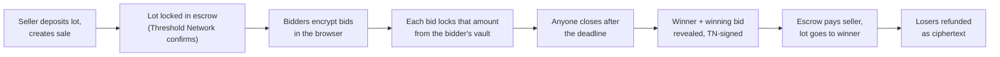

<div align="center">


### Sell your treasury without leaking it.

**Sealed-bid block sales, an encrypted treasury and private payroll, built on Fhenix FHE (CoFHE 1.0, ERC-7984 tokens).**

[-16a34a?style=flat-square)](https://sepolia.etherscan.io/address/0x42C620C7014E5fe40b8C6B8c1bc12AAde1db47aB#code)
[](https://cofhesdk.fhenix.io)
[](#contracts)
[](#security)
[](./LICENSE)

**[Live app](https://www.zerithfi.tech)** · **[Quickstart](https://www.zerithfi.tech/quickstart)** · **[Docs](https://www.zerithfi.tech/docs)** · **[Privacy audit](https://www.zerithfi.tech/audit)**

</div>

> **Testnet only.** Zerith runs on Ethereum Sepolia with test tokens. It has not had an external security audit. Don't use it with anything of value.

---

## What it does

A token foundation selling a large block of its own token on a public chain leaks its price floor, its size and every counter-offer. Zerith keeps the numbers encrypted while the chain still settles the trade.

| | What you do | What stays private |
|---|---|---|
| **Sell** — sealed block sales | Put a lot up for sale; bidders submit encrypted bids | Every losing bid, forever. With a Blind Floor reserve, the reserve too. |
| **Hold** — encrypted treasury | Deposit tokens into a vault with an encrypted balance; prove "I hold at least X" | Your balance. A proof reveals only yes/no for the threshold you chose. |
| **Pay** — private payroll | Pay several recipients in one split | Each recipient's amount and the total. Each recipient can read only their own. |

## How a sealed sale works

Every bid and the lot are **locked in escrow** in the settlement vault, so settlement is atomic: the winner always pays exactly the winning bid and always receives the lot.



- Bids are compared as ciphertext (`FHE.gt`, `FHE.max`). Only the amount a bidder **actually locked** competes. A bid from a wallet that can't cover it locks nothing and can't win.
- Encrypted values passed between contracts (feature contract ↔ vault ↔ ERC-7984 token) are shared handles (`FHE.shareEuint64` / `receiveEuint64FromCall`), so no contract can act on a value it wasn't explicitly handed.
- After the deadline, anyone can close and reveal. The contract checks the signature from Fhenix's decryption network on the outcome (`FHE.verifyDecryptResult`).
- Losing bids are never decrypted. They are refunded as encrypted amounts.
- **Blind Floor:** the seller's reserve is encrypted and never decrypted. If it isn't met, neither the reserve, the winner nor any bid is revealed, and everyone is refunded.

## Verify it on-chain

A full sale on Sepolia, run on 2026-10-12 by [`tasks/verify-escrow-auction-e2e.ts`](./tasks/verify-escrow-auction-e2e.ts) against Fhenix's live testnet (auction #0 on the current contracts):

| Step | Transaction |
|---|---|
| Lot locked and confirmed by Fhenix's decryption network | [`0xa0e2d896…23d1`](https://sepolia.etherscan.io/tx/0xa0e2d8967ffbb8a804995a4da1ab70e6d6d0f446218544a5cd9d9709f6bb23d1) |
| Bids: 300 and 450 CDEX (funded), 5,000 CDEX from a wallet with an **empty** vault | [`0x34eb8b62…`](https://sepolia.etherscan.io/tx/0x34eb8b62f3c20c11da2c797e7572f85f3eb7fc5a8d82830153faf1f1a8d1b4ea) · [`0x860f5a47…`](https://sepolia.etherscan.io/tx/0x860f5a470da30f219c69c9a4b98cda9ec04e81c02a0d718f79390a45a40ac607) · [`0x1808835c…`](https://sepolia.etherscan.io/tx/0x1808835cf6f4fd67727d97fd3c0ff1e6a8c26fd421a320fe42f69133943d2fb9) |
| Reveal: winner is the 450 bidder (the unfunded 5,000 bid couldn't win) | [`0x0b989da4…0a511`](https://sepolia.etherscan.io/tx/0x0b989da475cb37b0aa26a35c9b4dafa13b05ed22c7f56ffd6129ed2f0bb0a511) |
| Settlement from escrow: seller gets 441 (450 − 2% fee), winner gets the 2,000 MOCK lot | [`0x061ea130…23ed`](https://sepolia.etherscan.io/tx/0x061ea1304e8b68099fa3b97fb7a6fda83cde280ee803a9c1ab88ec397438e4ed) |
| Losing bid refunded as ciphertext | [`0x1f519817…`](https://sepolia.etherscan.io/tx/0x1f519817026700bf2a09815caa0f4d9fb104bac911372c0af3795d07c8f72b95) |

Each party then unsealed its own balance:
- **Winner:** 550 CDEX and the 2,000 MOCK lot.
- **Loser:** 1,000 CDEX, fully refunded.
- **Empty-vault bidder:** got nothing.

Payroll and proof of reserves are covered by [`tasks/verify-escrow-payroll-e2e.ts`](./tasks/verify-escrow-payroll-e2e.ts). Same day, every check passed:
- **Proofs:** "holds ≥ 1,000" was proven ([`0x68f3ed76…`](https://sepolia.etherscan.io/tx/0x68f3ed761fa14087f674b2c77e44f0b7cdc31f3256668af0bcfed0d1eee351bc)), and "holds ≥ 1,001" was not ([`0x9c069d67…`](https://sepolia.etherscan.io/tx/0x9c069d6753385d78c8eddf2a5450c3d2ac39f76cb5699bc565f02441cde17a69)).
- **Split:** a 120 / 80 split ([`0xc8e20291…`](https://sepolia.etherscan.io/tx/0xc8e20291f278c2db83ed447a1dcfb15bfd7d57b5c18da467285b73c07b4773b2)) paid recipient 1 their 120.
- **Cancel:** cancelling ([`0xe9daf1f6…`](https://sepolia.etherscan.io/tx/0xe9daf1f6d64c2e96fd6366da262a48293d6a7132a21a5972fc496e4f79080a66)) returned the unclaimed 80.
- **Privacy:** each party could read only its own numbers.

## What's private, what's public

| Public on-chain | Encrypted |
|---|---|
| Who created a sale, lot token and size, payment token, deadline, number of bids | Every bid amount; the reserve |
| Who placed a bid (addresses) | Vault balances |
| The winner and the winning bid, after reveal | Losing bids, forever |
| Payroll creator and recipient list | Each payroll amount and the total |
| Proof-of-reserves threshold and its yes/no result | The balance behind the proof |

The full schema, with the FHE calls each contract makes (generated from the source), is on the [privacy audit page](https://www.zerithfi.tech/audit).

## Trust assumptions

- **Fhenix's decryption network.** Decryptions (lot confirmation, reveals, proofs, your own unseals) are done by Fhenix's network. Contracts verify one signature from it on-chain; how that signature is produced happens off-chain. In principle that network can decrypt any value.
- **One owner key.** The contracts' admin functions (pause, fee settings, which contracts may use escrow) are controlled by a single deployer key on testnet. Moving this to a multisig is required before mainnet.
- **If Fhenix's decryption network is down,** sales can't confirm or reveal until it's back. Escrowed funds stay locked meanwhile; there's no on-chain timeout that refunds them without a reveal.

## Try it

**In the browser (no install, no MetaMask):** open [/quickstart](https://www.zerithfi.tech/quickstart). It walks five real transactions:
1. Create a burner wallet in your browser.
2. Fund your vault with test tokens.
3. Place an encrypted bid on a live sale.
4. Unseal your own bid.
5. See the same sale as yourself, a counterparty and an outside observer.

The burner's key never leaves your browser. The server only sends it a little Sepolia ETH for gas.

**Locally:**

```bash
git clone https://github.com/Ritik200238/zerith.git && cd zerith
npm install
npm test                     # contract tests on the Fhenix mock coprocessor

cp .env.example .env         # PRIVATE_KEY (a Sepolia-funded wallet), SEPOLIA_RPC_URL
FRESH=1 npm run deploy:sepolia   # deploy your own tokens + core contracts
npm run seed:sepolia             # open two long-running sales
npm run e2e:sepolia              # full sale against the real Threshold Network

cd frontend && npm install
cp .env.example .env.local   # BURNER_FUNDER_PRIVATE_KEY, SEPOLIA_RPC_URL, NEXT_PUBLIC_REOWN_PROJECT_ID
npm run copy-abis && npm run dev
```

## Contracts

Ethereum Sepolia (chainId `11155111`), deployed 2026-10-12 on CoFHE 1.0. All source verified on Etherscan.

| Contract | Address |
|---|---|
| `SealedAuction` | [`0x42C620C7014E5fe40b8C6B8c1bc12AAde1db47aB`](https://sepolia.etherscan.io/address/0x42C620C7014E5fe40b8C6B8c1bc12AAde1db47aB#code) |
| `SettlementVault` | [`0x28ab1735988cD549FfBC6ebE5383a5ae83534D17`](https://sepolia.etherscan.io/address/0x28ab1735988cD549FfBC6ebE5383a5ae83534D17#code) |
| `PrivatePayments` | [`0xD10f93f12c9bbd69a85d5ec654038CC8201fB49C`](https://sepolia.etherscan.io/address/0xD10f93f12c9bbd69a85d5ec654038CC8201fB49C#code) |
| `ProofOfReserves` | [`0x8b3df8FD07aBE76157CFbeb512600B6256795C39`](https://sepolia.etherscan.io/address/0x8b3df8FD07aBE76157CFbeb512600B6256795C39#code) |
| `ConfidentialToken` — CDEX ("Zerith Test Dollar", ERC-7984, faucet) | [`0x9233B71feB89Bddd14B30Ddc5de171541E9bBC90`](https://sepolia.etherscan.io/address/0x9233B71feB89Bddd14B30Ddc5de171541E9bBC90#code) |
| `ConfidentialToken` — MOCK ("Mock Project Token", the lot side) | [`0xEEAcA4dC06534E150Ee41e772BE675bCDF830150`](https://sepolia.etherscan.io/address/0xEEAcA4dC06534E150Ee41e772BE675bCDF830150#code) |
| `PlatformRegistry` | [`0x3B7B81E6B2D6b2F4904Bef744fCfdcE3a8bc5616`](https://sepolia.etherscan.io/address/0x3B7B81E6B2D6b2F4904Bef744fCfdcE3a8bc5616#code) |
| `AuctionClaim` (winner NFT) | [`0x3065150c4fbf0dC767D3669F5a3B2Ad056be3De9`](https://sepolia.etherscan.io/address/0x3065150c4fbf0dC767D3669F5a3B2Ad056be3De9#code) |

The CDEX symbol comes from the project's earlier name.

## Repository

```
contracts/            core contracts (CoFHE 1.0)
  core/               SettlementVault, ConfidentialToken, PlatformRegistry, AuctionClaim
  features/           SealedAuction, PrivatePayments, ProofOfReserves
  vendor/fherc20/     FHERC20 0.4.0 (ERC-7984), the token Fhenix's docs point to
test/unit/            Hardhat tests, including the review's attack scenarios
tasks/                deploy-core, seed-live-auctions, Sepolia end-to-end checks
frontend/             Next.js app (www.zerithfi.tech)
legacy-contracts/     paused features, with their old tests and scripts
```

## Paused features

Zerith once shipped about 20 more features: Vickrey, Dutch, batch and overflow auctions, OTC, an order book, limit orders, escrow, freelance bidding, streaming, multisig, DAO voting, vesting, royalties, referrals, reputation, raffles and a token wrapper.

They're paused for two reasons:
- **Settlement bugs.** Our October 2026 review found settlement bugs in several of them (each side of a trade settled separately, unchecked encrypted arithmetic).
- **Stale encryption format.** Their contracts predate Fhenix's CoFHE 1.0 input format, which the testnet now requires.

Their code is in [`legacy-contracts/`](./legacy-contracts/), and their pages in the app explain the pause. Each comes back only once it's moved onto the same escrowed settlement as the core.

## Security

The October 2026 review fixed, with a test for each:

| Finding | Fix |
|---|---|
| The vault credited deposits the token never moved, so an empty wallet could withdraw other users' funds | Credit only what the token reports as transferred |
| Bids locked nothing and each settlement leg was separate, so a bidder with an empty vault could win the lot and pay 0 | Lots and bids are escrowed; settlement pays from escrow |
| Bids were euint128 but settled as euint64, so huge bids wrapped | Bids are euint64 end to end |
| The vault passed bare encrypted handles to the token, a pattern Fhenix's docs call a possible disclosure path | Tokens are ERC-7984 (FHERC20 0.4); every cross-contract value is a shared handle |
| Users approved the vault as token operator forever | Approvals last 10 minutes, per Fhenix's FHERC20 guidance |
| Payroll was never funded, and its total was public | Splits lock the encrypted total up front (overflow-checked); the total is private |
| Only the seller could close a sale, so a seller could stall it forever | Anyone can close after the deadline |
| A Blind Floor sale that missed its reserve still revealed the top bid | Nothing about any bid is revealed when the reserve isn't met |

Still open, and required before mainnet:
- an external audit
- moving contract ownership to a multisig
- persistent rate limiting for the demo gas faucet (Upstash support is built in; it needs configuring)

**Report a vulnerability** through a [GitHub security advisory](https://github.com/Ritik200238/zerith/security/advisories/new).

## License

[MIT](./LICENSE). Live app: <https://www.zerithfi.tech> · Contact: <https://www.zerithfi.tech/contact>
