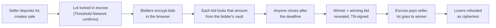

<div align="center">


### Sell your treasury without leaking it.

**Sealed-bid block sales, an encrypted treasury and private payroll, built on Fhenix FHE (CoFHE 1.0).**

[-16a34a?style=flat-square)](https://sepolia.etherscan.io/address/0x3B29F7F773E5554c3f46Cc8d4236d109AE3FfE08#code)
[](https://cofhesdk.fhenix.io)
[](#contracts)
[](#security)
[](./LICENSE)

**[Live app](https://www.zerithfi.tech)** · **[Quickstart](https://www.zerithfi.tech/quickstart)** · **[Docs](https://www.zerithfi.tech/docs)** · **[Privacy audit](https://www.zerithfi.tech/audit)**

</div>

> **Testnet only.** Zerith runs on Ethereum Sepolia with test tokens. It has not had an external security audit. Don't use it with anything of value.

---

## What it does

A token foundation selling a large block of its own token on a public chain leaks its price floor, its size and every counter-offer. Zerith keeps the numbers encrypted while the chain still settles the trade.

| | What you do | What stays private |
|---|---|---|
| **Sell** — sealed block sales | Put a lot up for sale; bidders submit encrypted bids | Every losing bid, forever. With a Blind Floor reserve, the reserve too. |
| **Hold** — encrypted treasury | Deposit tokens into a vault with an encrypted balance; prove "I hold at least X" | Your balance. A proof reveals only yes/no for the threshold you chose. |
| **Pay** — private payroll | Pay several recipients in one split | Each recipient's amount and the total. Each recipient can read only their own. |

## How a sealed sale works

Every bid and the lot are **locked in escrow** in the settlement vault, so settlement is atomic: the winner always pays exactly the winning bid and always receives the lot.



- Bids are compared as ciphertext (`FHE.gt`, `FHE.max`). Only the amount a bidder **actually locked** competes. A bid from a wallet that can't cover it locks nothing and can't win.
- After the deadline, anyone can close and reveal. The contract checks the Threshold Network's signature on the outcome (`FHE.publishDecryptResult`).
- Losing bids are never decrypted. They are refunded as encrypted amounts.
- **Blind Floor:** the seller's reserve is encrypted and never decrypted. If it isn't met, neither the reserve, the winner nor any bid is revealed, and everyone is refunded.

## Verify it on-chain

A full sale on Sepolia, run on 2026-10-12 by [`tasks/verify-escrow-auction-e2e.ts`](./tasks/verify-escrow-auction-e2e.ts) against the real Threshold Network (auction #1):

| Step | Transaction |
|---|---|
| Lot locked and confirmed by the Threshold Network | [`0x563f25d5…b8d44f`](https://sepolia.etherscan.io/tx/0x563f25d5a36ec7beebaf1500aa38ff7640a006b80719b0f42f56273425b8d44f) |
| Bids: 300 and 450 CDEX (funded), 5,000 CDEX from a wallet with an **empty** vault | [`0x2eb59536…`](https://sepolia.etherscan.io/tx/0x2eb59536629a0d3077494dcb1c1dd658ca6fab0f92d533959d5c75d68d6dc20c) · [`0xe0cbc383…`](https://sepolia.etherscan.io/tx/0xe0cbc3835842b5341c3d6b50955f19542049584e9407fca72deb952d7bba18c4) · [`0x2b015981…`](https://sepolia.etherscan.io/tx/0x2b01598173ec2e1cb550f0b48e29676d0fe422bfb282bd9c6899dc4949e3901f) |
| Reveal: winner is the 450 bidder (the unfunded 5,000 bid couldn't win) | [`0x609f9342…a8cb`](https://sepolia.etherscan.io/tx/0x609f93426d4374df8f249f24c8e293c3f97bd62072719ddc4bc4576871bca8cb) |
| Settlement from escrow: seller gets 441 (450 − 2% fee), winner gets the 2,000 MOCK lot | [`0x19dd547d…1ebc`](https://sepolia.etherscan.io/tx/0x19dd547dc3b99a01ba101b7f14e3b500d6c502770c237a06136a180755be1ebc) |
| Losing bid refunded as ciphertext | [`0x1cba9b1a…`](https://sepolia.etherscan.io/tx/0x1cba9b1aee2390bde0a8828ed4c487672b007aedf302ef621778a6fa2afbd1e9) |

Each party then unsealed its own balance: the winner held 550 CDEX and the 2,000 MOCK lot, the loser 1,000 CDEX, and the empty-vault bidder nothing.

Payroll and proof of reserves are covered by [`tasks/verify-escrow-payroll-e2e.ts`](./tasks/verify-escrow-payroll-e2e.ts). In the 2026-10-12 run:
- **Proofs:** "holds ≥ 1,000" verified true, and "holds ≥ 1,001" verified false.
- **Split:** a 120 / 80 split paid recipient 1 their 120, and cancelling returned the unclaimed 80.
- **Balances:** each party read only its own.

## What's private, what's public

| Public on-chain | Encrypted |
|---|---|
| Who created a sale, lot token and size, payment token, deadline, number of bids | Every bid amount; the reserve |
| Who placed a bid (addresses) | Vault balances |
| The winner and the winning bid, after reveal | Losing bids, forever |
| Payroll creator and recipient list | Each payroll amount and the total |
| Proof-of-reserves threshold and its yes/no result | The balance behind the proof |

The full schema, with the FHE calls each contract makes (generated from the source), is on the [privacy audit page](https://www.zerithfi.tech/audit).

## Trust assumptions

- **Fhenix Threshold Network.** Decryptions (lot confirmation, reveals, proofs, your own unseals) are done by Fhenix's network. Contracts verify one signature from it on-chain; any operator quorum is off-chain. In principle that network can decrypt any value.
- **One owner key.** The contracts' admin functions (pause, fee settings, which contracts may use escrow) are controlled by a single deployer key on testnet. Moving this to a multisig is required before mainnet.
- **If the Threshold Network is down,** sales can't confirm or reveal until it's back. Escrowed funds stay locked meanwhile; there's no on-chain timeout that refunds them without a reveal.

## Try it

**In the browser (no install, no MetaMask):** open [/quickstart](https://www.zerithfi.tech/quickstart). It walks five real transactions:
1. Create a burner wallet in your browser.
2. Fund your vault with test tokens.
3. Place an encrypted bid on a live sale.
4. Unseal your own bid.
5. See the same sale as yourself, a counterparty and an outside observer.

The burner's key never leaves your browser. The server only sends it a little Sepolia ETH for gas.

**Locally:**

```bash
git clone https://github.com/Ritik200238/zerith.git && cd zerith
npm install
npm test                     # contract tests on the Fhenix mock coprocessor

cp .env.example .env         # PRIVATE_KEY (a Sepolia-funded wallet), SEPOLIA_RPC_URL
FRESH=1 npm run deploy:sepolia   # deploy your own tokens + core contracts
npm run seed:sepolia             # open two long-running sales
npm run e2e:sepolia              # full sale against the real Threshold Network

cd frontend && npm install
cp .env.example .env.local   # BURNER_FUNDER_PRIVATE_KEY, SEPOLIA_RPC_URL, NEXT_PUBLIC_REOWN_PROJECT_ID
npm run copy-abis && npm run dev
```

## Contracts

Ethereum Sepolia (chainId `11155111`). Core contracts redeployed 2026-10-12 on CoFHE 1.0, source verified on Etherscan.

| Contract | Address |
|---|---|
| `SealedAuction` | [`0x3B29F7F773E5554c3f46Cc8d4236d109AE3FfE08`](https://sepolia.etherscan.io/address/0x3B29F7F773E5554c3f46Cc8d4236d109AE3FfE08#code) |
| `SettlementVault` | [`0xb6e0D910Ea85d365820A96ffb9cC0Ebd9A169Ad2`](https://sepolia.etherscan.io/address/0xb6e0D910Ea85d365820A96ffb9cC0Ebd9A169Ad2#code) |
| `PrivatePayments` | [`0x132053d697E0fd79A216DC4E7a4b3E1317a435B1`](https://sepolia.etherscan.io/address/0x132053d697E0fd79A216DC4E7a4b3E1317a435B1#code) |
| `ProofOfReserves` | [`0x2Cc1F8DE2f07051e94BB8305942882134890B106`](https://sepolia.etherscan.io/address/0x2Cc1F8DE2f07051e94BB8305942882134890B106#code) |
| `ConfidentialToken` (CDEX test token, faucet) | [`0x56047782ABFE56d88f1f29b12b3c0C22ee12a3d2`](https://sepolia.etherscan.io/address/0x56047782ABFE56d88f1f29b12b3c0C22ee12a3d2) |
| MOCK test token (the lot side) | [`0x949caC2113c0AF90b309Ec1A9136f7B159d1A672`](https://sepolia.etherscan.io/address/0x949caC2113c0AF90b309Ec1A9136f7B159d1A672) |
| `PlatformRegistry` | [`0x0a97e158D0679A29321AB97A54AF666269C5F5A8`](https://sepolia.etherscan.io/address/0x0a97e158D0679A29321AB97A54AF666269C5F5A8) |
| `AuctionClaim` (winner NFT) | [`0xD46b298b4c4ce04E65b37a7F594D8C8e7876f65c`](https://sepolia.etherscan.io/address/0xD46b298b4c4ce04E65b37a7F594D8C8e7876f65c) |

The CDEX symbol comes from the project's earlier name; token metadata can't change.

## Repository

```
contracts/            core contracts (CoFHE 1.0)
  core/               SettlementVault, ConfidentialToken, PlatformRegistry, AuctionClaim
  features/           SealedAuction, PrivatePayments, ProofOfReserves
  vendor/fherc20/     FHERC20 0.2.0 (what the live tokens run), inputs ported to CoFHE 1.0
test/unit/            Hardhat tests, including the review's attack scenarios
tasks/                deploy-core, seed-live-auctions, Sepolia end-to-end checks
frontend/             Next.js app (www.zerithfi.tech)
legacy-contracts/     paused features, with their old tests and scripts
```

## Paused features

Zerith once shipped about 20 more features: Vickrey, Dutch, batch and overflow auctions, OTC, an order book, limit orders, escrow, freelance bidding, streaming, multisig, DAO voting, vesting, royalties, referrals, reputation, raffles and a token wrapper.

They're paused for two reasons:
- **Settlement bugs.** Our October 2026 review found settlement bugs in several of them (each side of a trade settled separately, unchecked encrypted arithmetic).
- **Stale encryption format.** Their contracts predate Fhenix's CoFHE 1.0 input format, which the testnet now requires.

Their code is in [`legacy-contracts/`](./legacy-contracts/), and their pages in the app explain the pause. Each comes back only once it's moved onto the same escrowed settlement as the core.

## Security

The October 2026 review fixed, with a test for each:

| Finding | Fix |
|---|---|
| The vault credited deposits the token never moved, so an empty wallet could withdraw other users' funds | Credit only what the token reports as transferred |
| Bids locked nothing and each settlement leg was separate, so a bidder with an empty vault could win the lot and pay 0 | Lots and bids are escrowed; settlement pays from escrow |
| Bids were euint128 but settled as euint64, so huge bids wrapped | Bids are euint64 end to end |
| Payroll was never funded, and its total was public | Splits lock the encrypted total up front (overflow-checked); the total is private |
| Only the seller could close a sale, so a seller could stall it forever | Anyone can close after the deadline |
| A Blind Floor sale that missed its reserve still revealed the top bid | Nothing about any bid is revealed when the reserve isn't met |

Still open, and required before mainnet:
- an external audit
- moving contract ownership to a multisig
- persistent rate limiting for the demo gas faucet (Upstash support is built in; it needs configuring)

**Report a vulnerability** through a [GitHub security advisory](https://github.com/Ritik200238/zerith/security/advisories/new).

## License

[MIT](./LICENSE). Live app: <https://www.zerithfi.tech> · Contact: <https://www.zerithfi.tech/contact>
